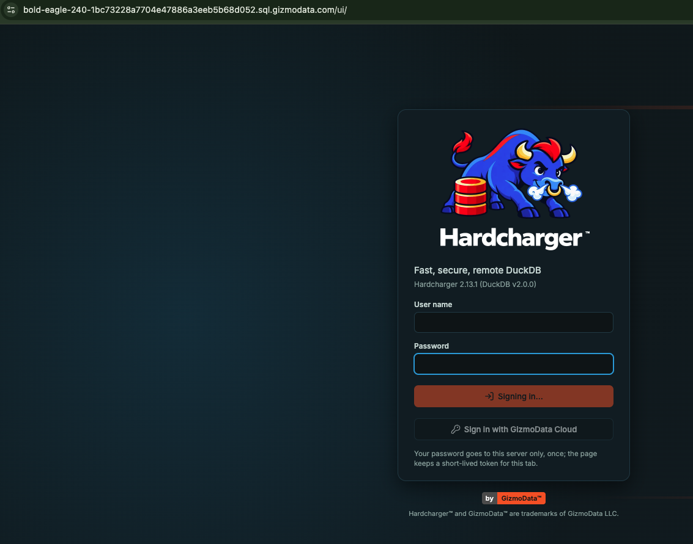
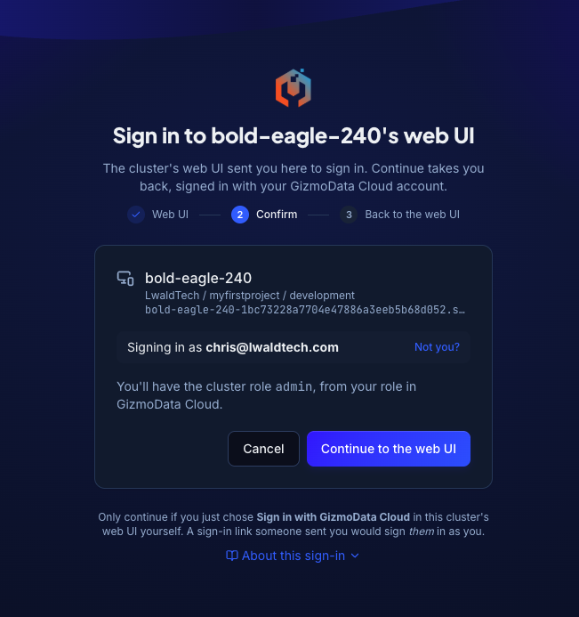
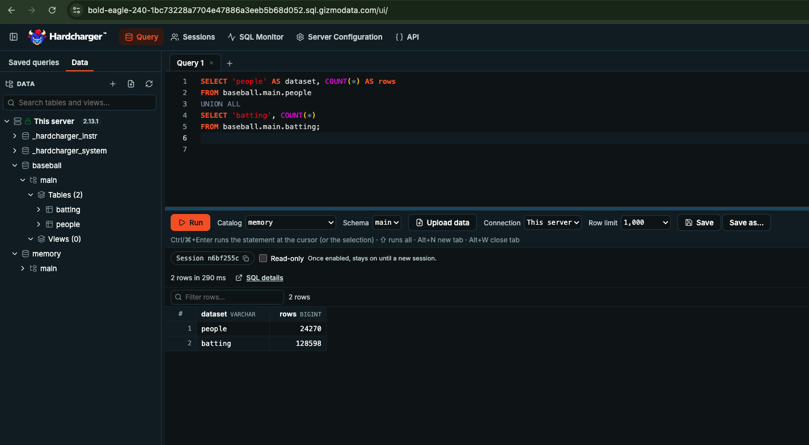

# Ask Baseball Questions with Claude, Hardcharger, and a Cluster That Wakes Up on Demand

*From two CSV files to persistent cloud tables, conversational SQL, and compute that stops when you stop using it.*

> **Draft status:** We created the cluster, imported both datasets, and verified the stored data and a joined query. The Claude Desktop connection and automatic-resume sequence below are a walkthrough to complete and record before publishing, not a claim that we have already demonstrated them. Product names and setup instructions were checked on November 17, 2026.

Baseball statistics. I've always wanted to ask AI this question but never really got around too it. The project gave me the opportunity and the purpose to do so. The question, "Who are the top 10 greatest hitters of all time?"

Two CSV files were enough. One described the players. The other contained their batting statistics. The goal was to put them somewhere I could query with SQL, connect Claude Desktop, and ask questions without uploading the entire dataset into a conversation.

Then there was the feature I really wanted to try: **let the cluster stop when I am not using it, and wake it back up when I ask another question.**

Here is the walkthrough.

## What we are building

The platform is **GizmoData Cloud**, and the database server we selected is **Hardcharger**, GizmoData's DuckDB 2.0 server. GizmoSQL is also available but being depreciated in favor of Hardcharger.

The pieces fit together like this:

```text
People.csv + Batting.csv
          |
          | Python ADBC bulk ingest
          v
Persistent DuckLake catalog: baseball
  main.people
  main.batting
          ^
          | mounted on
          |
Hardcharger cluster on GizmoData Cloud
          ^
          | authenticated queries
          |
GizmoData Cloud MCP connector
          ^
          |
Claude Desktop
```

The important distinction is **compute versus storage**. The cluster runs the queries. The DuckLake catalog keeps the data independently of whether that cluster is running.

## 1. Create a small Hardcharger cluster

In the [GizmoData Cloud portal](https://app.gizmodata.com/), select your project and environment, then choose **Create a Hardcharger Cluster**.

For this project, we used:

| Setting | Our choice |
|---|---|
| Cluster name | `bold-eagle-240` (random) |
| Cloud and region | Microsoft Azure, East US 2 |
| Database server | Hardcharger |
| Image | `hardcharger-latest` |
| Compute size | Azure shared Pico: 0.25 vCPU, 2 GB RAM |
| Authentication | Managed |
| Endpoint | Shared gateway, TLS on port 443 |
| Hardcharger web UI | Enabled |
| Sign in with GizmoData Cloud | Enabled |
| Stop when idle | After 15 minutes |
| Auto-resume | Enabled |
| Auto-Stop | After 60 minutes running |
| Autoscaling | Off, one fixed replica |

We used **Create & Start**, then waited for the cluster status to become **running**.

The portal quoted **$0.029 per compute hour** for this size when we created it. That is a point-in-time compute price, not an all-inclusive bill: subscription, storage, and other applicable charges need to be considered separately.

Our initial sample allowed connections from any IP address. That is a demo choice, not a requirement; use appropriate network restrictions for your environment. Keep TLS enabled and credentials out of screenshots, source code, and blog posts.

**Screenshot to capture:** The running cluster and its Pico configuration, with credentials and account identifiers hidden.

## 2. Create a persistent catalog before loading data

An empty cluster is not automatically a persistent database.

Our cluster initially had no database mounts. Creating tables in its default in-memory database would not give us the durability we wanted across stops and starts. Selecting a data-volume size in the wizard did not, by itself, create a mounted database file.

Instead, we created a managed DuckLake catalog:

1. Open **Data → Catalogs**.
2. Select **Create Catalog**.
3. Choose **DuckLake → Fully managed**.
4. Name it `baseball`.
5. Keep it scoped to the project's development environment.
6. Choose **Microsoft Azure → East US 2**, matching the cluster.
7. Review the settings and create the catalog.
8. Open the catalog, select **Attach to running cluster**, and choose `bold-eagle-240`.

The managed catalog uses PostgreSQL for metadata and Azure Blob Storage for table data. We did not have to provision either ourselves.

Once attached, we could target tables explicitly:

```sql
SELECT * FROM baseball.main.people;
```

Here, `baseball` is the catalog, `main` is the schema, and `people` is the table. Using the full name avoids accidentally querying or creating something in an in-memory database.

**Screenshot to capture:** The `baseball` catalog and its attachment to the cluster.

## 3. Import the player and batting data

The source is the [SABR Lahman Baseball Database](https://sabr.org/lahman-database/), created by Sean Lahman. Consult its documentation and applicable usage terms for attribution and redistribution.

We used the two CSV files already in this project:

| File | Destination | Rows | Columns |
|---|---|---:|---:|
| `People.csv` | `baseball.main.people` | 24,270 | 25 |
| `Batting.csv` | `baseball.main.batting` | 128,598 | 22 |

Those counts describe our files, not a guarantee about every Lahman release.

`People.csv` contains names, biographical information, and a `playerID`. `Batting.csv` contains batting records by player, year, and stint, including team and league identifiers.

That last detail matters: **one batting row is not necessarily one player's entire season**. A player can have multiple rows in a year, so season and career questions need aggregation.

### The loading approach

We used the official Python ADBC driver and PyArrow to read the local CSVs and stream Arrow data to the remote cluster. The server cannot read a path on my laptop just because I put that path in SQL.

The project already had the driver dependency:

```sh
python3 -m venv .venv
.venv/bin/python -m pip install -r requirements.txt
```

The following is a compact reproduction of the import. Replace the hostname with your cluster's endpoint and run it from the directory containing the CSVs:

```python
import getpass

import pyarrow.csv as csv
from adbc_driver_hardcharger import dbapi as hardcharger


uri = input("Cluster URI (hardcharger://YOUR_CLUSTER_HOST:443): ").strip()
username = input("Administrator username: ").strip()
password = getpass.getpass("Administrator password: ")

with hardcharger.connect(
    uri=uri,
    username=username,
    password=password,
    autocommit=False,
) as conn:
    with conn.cursor() as cur:
        for filename, table_name in [
            ("People.csv", "people"),
            ("Batting.csv", "batting"),
        ]:
            data = csv.read_csv(
                filename,
                read_options=csv.ReadOptions(block_size=16 * 1024 * 1024),
                convert_options=csv.ConvertOptions(strings_can_be_null=True),
            )
            cur.adbc_ingest(
                table_name=table_name,
                data=data,
                mode="create",
                catalog_name="baseball",
                db_schema_name="main",
            )
            cur.execute(
                operation=f'SELECT count(*) FROM baseball.main."{table_name}"'
            )
            actual = cur.fetchone()
            if actual != (data.num_rows,):
                raise RuntimeError(f"{table_name}: unexpected count {actual}")
            print(f"{table_name}: {data.num_rows:,} rows verified")
    conn.commit()
```

The interpolated table names come only from the fixed list above, not user input. For user-supplied query values, use bound parameters.

`mode="create"` deliberately refuses to overwrite an existing table. This is a one-time import, not an append-every-time script.

PyArrow handled the byte-order mark in our people file and inferred integer statistics, string identifiers, and date columns. Empty fields became nulls under the reader's conversion rules; for a different CSV export, review those rules and inferred types before loading.

### Verify more than a successful upload

For the actual import, we checked the row counts and player IDs before committing. Then we opened a **new connection**, read both tables back, and compared every value and column type with the parsed CSV data, ignoring row order.

We also checked the relationship:

```sql
SELECT COUNT(*) AS unmatched_batting_rows
FROM baseball.main.batting AS b
LEFT JOIN baseball.main.people AS p USING (playerID)
WHERE p.playerID IS NULL;
```

The result was **0**. We also verified that the people table had no null or duplicate `playerID` values.

That validates the join for this dataset; it does not mean we created a database-enforced foreign key.

## 4. Try SQL in the Hardcharger web UI

Before adding an AI assistant, it helps to verify the database directly.

From the cluster page, use **Connect**, or open:

```text
https://YOUR_CLUSTER_HOST/ui/
```





We enabled GizmoData Cloud sign-in when creating the cluster. The UI provides a SQL editor, a schema browser, and a results grid.

Run this first:

```sql
SELECT 'people' AS dataset, COUNT(*) AS rows
FROM baseball.main.people
UNION ALL
SELECT 'batting', COUNT(*)
FROM baseball.main.batting;
```



You should see the two counts from the import. On macOS, **Command+Enter** runs the current statement or selection.


## 5. Connect Claude Desktop through MCP

MCP gives Claude tools to discover schemas and run queries against the database. It is not the same as attaching the CSVs to a chat.

For a managed Hardcharger cluster, the simplest current route is the **hosted GizmoData Cloud connector**.

### Recommended: hosted connector with browser sign-in

1. In GizmoData Cloud, open **AI Assistants** and review the connection instructions.
2. On the cluster's AI Assistants settings, ensure **Available to AI assistants** is enabled. Leave changes disabled for this read-only exploration.
3. In Claude Desktop, open the connectors area, currently **Customize → Connectors**, and choose **Add custom connector**. Team or Enterprise accounts may require an administrator to add it first.
4. Name it `GizmoData Cloud` and enter this remote MCP URL:

   ```text
   https://mcp.gizmodata.com/mcp
   ```

5. Connect and complete the GizmoData Cloud browser sign-in.
6. Enable the connector for the conversation and review tool permissions.

Use the **MCP URL**, not the cluster's SQL endpoint or `/ui/` address. No cluster password, portal session token, or API key needs to be pasted into this connector configuration.

The connector operates with your GizmoData Cloud identity. For this project, keep assistant access read-only and review the SQL Claude proposes. A prompt asking for read-only behavior is useful, but it is not a substitute for enforced permissions.

Remote connectors send tool requests and results through the assistant provider's infrastructure. Only connect data you are authorized to share with that provider.

### Alternative: the local Hardcharger Desktop extension

If you prefer a local MCP process configured for a particular server, the official [Hardcharger MCP project](https://github.com/gizmodata/hardcharger-mcp) also provides a Claude Desktop extension:

1. Download `hardcharger-mcp.mcpb` from its official releases.
2. Install it through **Settings → Extensions → Advanced settings → Install Extension**, or open the bundle.
3. Enter `hardcharger://YOUR_CLUSTER_HOST:443` and an appropriate credential in the extension's settings.
4. Enable **Hardcharger** in the conversation's connectors menu.

The extension marks credentials as sensitive and stores them in the operating system's keychain. Use a least-privileged credential rather than an administrator account for routine analysis. You only need one of these connection approaches.

**Screenshot to capture:** Claude's enabled connector and a successful schema-discovery response, with private account details hidden.

## 6. Ask baseball questions, then inspect the SQL

Start by giving Claude clear boundaries:

> Use the GizmoData Cloud connector and select the `bold-eagle-240` cluster. Inspect `baseball.main.people` and `baseball.main.batting`. Use read-only queries, show me the SQL, and do not invent columns or results.

Tool names differ between the hosted connector and local extension, so the important thing is the workflow: discover the schema, execute SQL, and explain the returned results.

### Question 1: Who hit the most career home runs?

> Join the batting records to the people table and show the top five players by total career home runs in this dataset. Group by player ID so players with the same name are not merged.

The SQL can look like this:

```sql
SELECT
    p.playerID,
    p.nameFirst,
    p.nameLast,
    SUM(b.HR) AS career_home_runs
FROM baseball.main.people AS p
JOIN baseball.main.batting AS b USING (playerID)
GROUP BY p.playerID, p.nameFirst, p.nameLast
ORDER BY career_home_runs DESC, p.playerID
LIMIT 5;
```

We already verified the underlying career-home-run aggregation against the imported tables:

| Player | Career home runs |
|---|---:|
| Barry Bonds | 762 |
| Hank Aaron | 755 |
| Babe Ruth | 714 |
| Albert Pujols | 703 |
| Alex Rodriguez | 696 |

These are totals in our imported data, not a claim that every historical comparison is complete or directly comparable across leagues and eras.

### Question 2: Who had the highest batting average in 2024?

> Find the ten highest batting averages in 2024 among players with at least 400 at-bats. Aggregate all stints for each player first. Show hits, at-bats, and batting average, and explain that this is my chosen cutoff, not the official batting-title qualification rule.

```sql
WITH season AS (
    SELECT
        playerID,
        SUM(H) AS hits,
        SUM(AB) AS at_bats
    FROM baseball.main.batting
    WHERE yearID = 2024
    GROUP BY playerID
    HAVING SUM(AB) >= 400
)
SELECT
    p.nameFirst,
    p.nameLast,
    s.hits,
    s.at_bats,
    ROUND(s.hits * 1.0 / NULLIF(s.at_bats, 0), 3) AS batting_average
FROM season AS s
JOIN baseball.main.people AS p USING (playerID)
ORDER BY
    s.hits * 1.0 / NULLIF(s.at_bats, 0) DESC,
    p.playerID
LIMIT 10;
```

Notice that we sort by the unrounded average, not the displayed three-decimal value.

### Question 3: Show a player's career over time

> Find Hank Aaron by player ID, then show his hits and home runs by year. Combine multiple stints within each year. Explain the trend using only the returned data.

```sql
SELECT
    yearID,
    SUM(H) AS hits,
    SUM(HR) AS home_runs
FROM baseball.main.batting
WHERE playerID = 'aaronha01'
GROUP BY yearID
ORDER BY yearID;
```

The point is not to stop thinking about SQL. It is to shorten the path from a question to a query you can inspect and reproduce.

**Screenshots to capture:** The prompt, actual tool execution, SQL, and returned results. The 2024 and year-by-year examples above are suggested queries; add their output only after running them.

## 7. The fun part: let the cluster sleep, then ask another question

This is the demo I want to finish with.

Our cluster has three related but distinct settings:

| Feature | What it does |
|---|---|
| Stop when idle: 15 minutes | Stops compute after the configured period without qualifying SQL activity |
| Auto-Stop: 60 minutes | Stops the cluster after that much running time, even if it has been used |
| Auto-resume | Lets an authenticated connection through a supported client start eligible stopped compute |

The 60-minute timer is not an idle timer. Its clock restarts each time the cluster starts.

### Record the end-to-end sequence

1. Run a small query through Claude to confirm the MCP connection works.
2. Stop issuing SQL. Pause other clients, scheduled jobs, or refreshes that could keep the cluster active.
3. Wait for the idle window and confirm the portal shows **stopped**. Leave enough time for shutdown to finish.
4. In Claude, ask:

   > Run a fresh query against `baseball.main.batting` on `bold-eagle-240` and tell me how many rows it contains. Do not reuse the answer from our earlier conversation.

5. Approve the tool call if prompted.
6. Watch the cluster start, wait for the query to complete, and capture the returned count: **128,598**.
7. Confirm that the tables are still available without reimporting either CSV.

The documented behavior is that a valid authenticated connection starts eligible stopped compute, and the hosted MCP connector waits for it to become ready. Invalid credentials do not start the cluster.

The first request is not instantaneous: GizmoData currently describes roughly 30 seconds for shared-compute resume, with startup work and capacity affecting the actual wait. Measure and report the time from the recording rather than treating that estimate as a guarantee.

**Demo storyboard:**

```text
Query completes
      |
      | no qualifying SQL activity for the idle window
      v
Cluster stopped; compute charges stop
      |
      | Claude makes a fresh authenticated query
      v
Cluster resumes; connector waits
      |
      v
Query returns; persistent baseball tables are still there
```

That is the cool part: I can come back with another baseball question instead of first remembering to turn the database on.

### A few important boundaries

- Auto-resume must be enabled on an eligible cluster. Our managed-authentication, single-replica, non-autoscaling Hardcharger configuration matches the documented requirements.
- Use the hosted MCP connector or another explicitly supported client for this demo. The current Cloud documentation says the portal SQL editor and web UI still require **Start**; do not assume every client behaves identically.
- Storage persists and is billed separately while compute is stopped. Subscription fees and any other applicable resources do not disappear either.
- Our shared gateway has no extra endpoint charge. A dedicated load balancer retained for auto-resume can still incur charges while stopped.
- Data survives because it is in the persistent catalog, not because stopping magically preserves an in-memory database.

**Capture before publication:** A stopped-cluster screenshot, the new Claude tool call, the running state, and the returned result. A sped-up idle-wait segment is fine if it is labeled.

## What I like about this setup

We started with two CSVs and ended with a small, persistent baseball dataset that supports both direct SQL and conversational exploration.

The stack is easy to reason about:

- **DuckLake** keeps the tables independent of the cluster's lifetime.
- **Hardcharger** runs DuckDB queries against them.
- **MCP** lets Claude discover and query the data through authenticated tools.
- **Idle stop and automatic resume** let compute rest between periods of use.

For a project like this, that last combination is especially appealing: the data stays ready, without requiring the query engine to stay running all day.

## References

- [GizmoData Cloud: clusters, catalogs, AI assistants, and automatic resume](https://gizmodata.com/cloud)
- [SABR Lahman Baseball Database](https://sabr.org/lahman-database/)
- [Hardcharger Python ADBC driver](https://docs.hardcharger.gizmodata.com/clients/python/)
- [Hardcharger bulk ingest](https://docs.hardcharger.gizmodata.com/guides/bulk-ingest/)
- [Hardcharger web UI](https://docs.hardcharger.gizmodata.com/guides/web-ui/)
- [Official Hardcharger MCP server and Claude Desktop extension](https://github.com/gizmodata/hardcharger-mcp)
- [Claude custom connectors using remote MCP](https://support.claude.com/en/articles/11175166-get-started-with-custom-connectors-using-remote-mcp)
